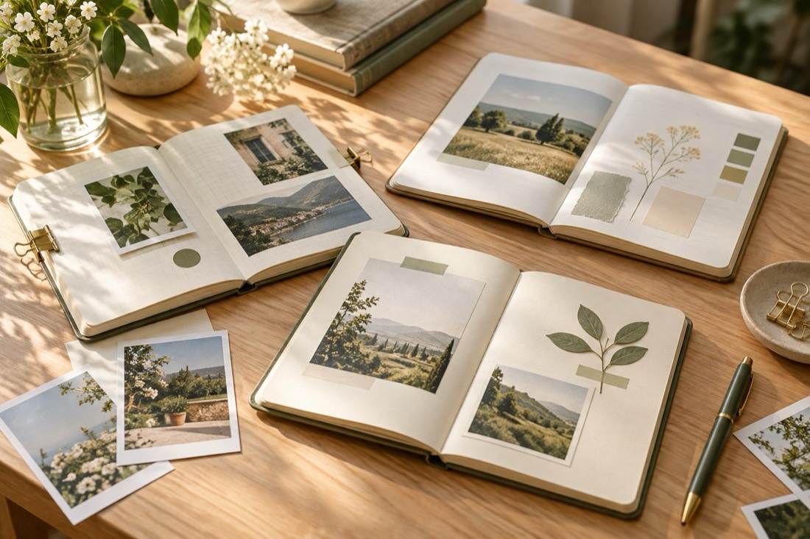

# 把零散灵感，整理成一篇好读的图文

有时我们已经有了想分享的内容：一段随手记下的话、几张喜欢的照片，还有一个没有想完的开头。真正让人迟迟不动笔的，往往不是缺少素材，而是不知道先从哪里整理。

这篇示例图文用三个简单步骤，把零散记录变成一篇结构清晰、看起来舒服的文章。

## 01　先找到最想表达的一句话

打开笔记，先别急着调整字号和颜色。试着问自己：读者看完这篇文章，最希望记住什么？把答案写成一句普通的话，放在文章开头。

例如：“好的表达，不一定要复杂；让重要的内容更容易被看见，就已经很有价值。”有了这句话，后面的段落就有了方向。

*示意图1：先写下核心想法，再决定如何排版。*

## 02　让每一段只讲一件事

把素材分成几个小组。一个小标题回答一个问题，一段正文只展开一个观点；相关图片放在对应内容附近，让读者不需要来回寻找解释。

排版时可以先统一正文，再处理小标题。正文保持稳定的字号和颜色，小标题用少量背景色帮助读者辨认层次。图片也尽量使用一致的圆角、对齐和间距。样式不需要很多，清楚就好。

*示意图2：将文字和图片按主题归组。*

## 03　完成后，再用读者的眼睛检查

一篇文章在编辑器里看起来整齐，还不是终点。保存后重新打开，检查段落、图片和小标题是否仍然正确；再用手机预览，看看字号是否易读、图片是否完整、前后节奏是否自然。

如果某个地方显得拥挤，就删去多余的装饰；如果重点不明显，就调整层次。好的图文不是把每一处都做得醒目，而是让读者顺畅地读下去。

*示意图3：保存并预览后，再做最后检查。*
